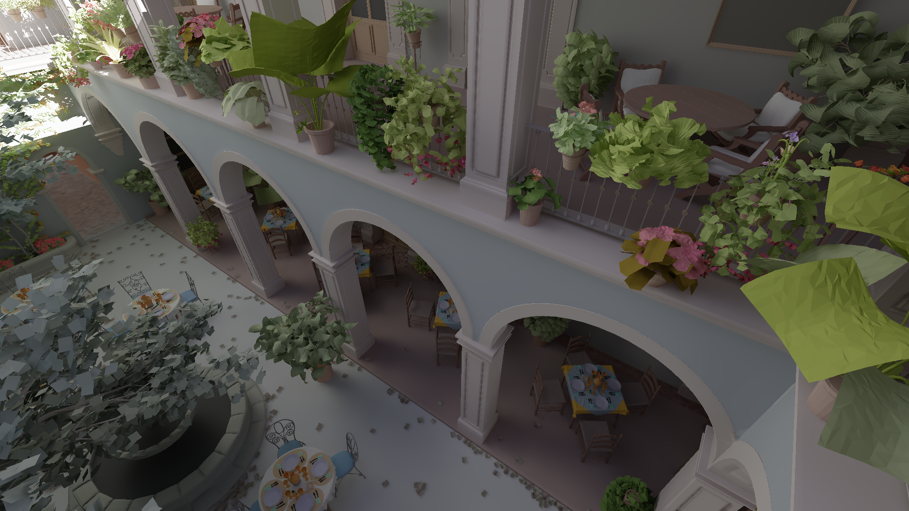

Chandra is an implementation of [Split Radiance Cascades](https://arxiv.org/abs/2607.20384); a 3D global illumination method utilizing sparse (hashmap-based) Radiance Cascades and ray splitting to reduce ray count. For more details, see [the paper](https://arxiv.org/abs/2607.20384).

File tree (`src/`):
- `algorithm/rc.rs`: Implementation of merging and ray splitting for Split RC.
- `algorithm/trace.rs`: Ray generation and tracing for Split RC.
- `algorithm/splat.rs`: Final shading / irradiance computation step; current codepath used is `shade_optimized_32` and `calculate_irradiance`.
- `cache.rs`: Radiance cache data structure implementation.
- `table.rs`: Hashmap implementation.
- `main.rs`: Entry point to the program.
- `algorithm/ddgi.rs`: DDGI implementation used in comparisons.
- `algorithm/ris.rs`: Reservoir sampling experiment.
- `algorithm/denoise.rs`: Bindings to OIDN for the denoised monte-carlo comparison.

Join the [Radiance Cascades Discord](https://discord.gg/EF9JfcEJPd) for more information and to discuss the algorithm!
