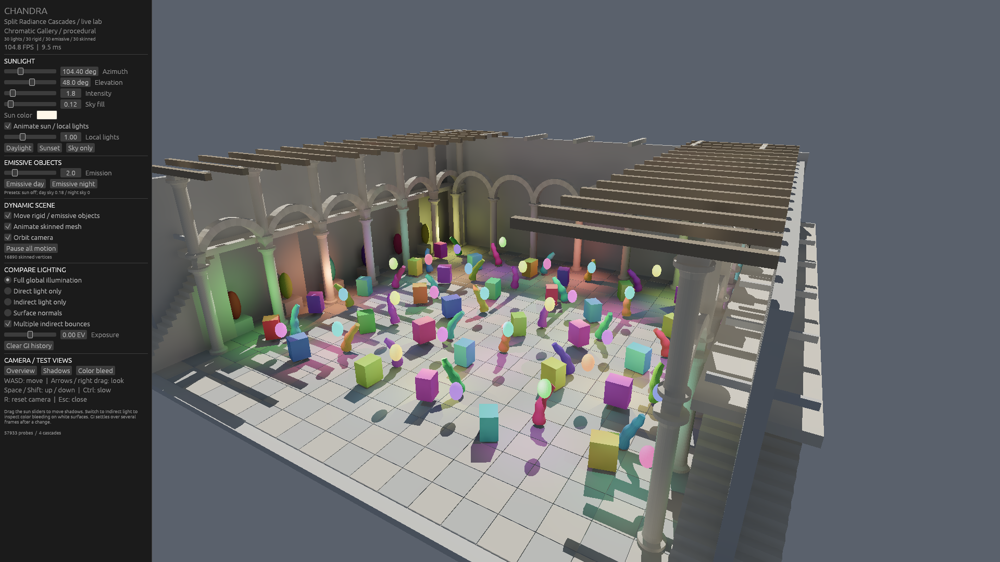

# Chandra Dynamic GI Lab

A dynamic-scene extension of [entropylost/chandra](https://github.com/entropylost/chandra), the reference implementation of [Split Radiance Cascades](https://arxiv.org/abs/2607.20384). The original research renderer is retained. This fork adds an interactive lighting lab, rigid instancing, GPU skinning, emissive materials, moving local lights, dynamic history invalidation and GPU timing tools.

**2026-10-27 / PICA PICA 近景性能修复：** 将有效历史观察次数与时间滤波权重分开，解除低帧率时稳定表面一直进入高采样档的反馈问题。PICA 漫反射次级查询复用每帧重建的 RC 余弦积分图，并优化漫反射任务分配。保留全分辨率反射、基础样本数和新显露区域补采样；新增近景及 20／30 Hz 条件下的性能与画面检查。见 [当前性能和验证记录](benchmarks/pica-pica/closeup-performance/README.md)。

**2026-10-27 / PICA PICA 收尾版本（历史记录）：** 保留 GGX／RC／RT 间接高光和完整材质，已移除 LTC 试验。反射使用短射线任务与实际队列长度调度。外侧视角、固定 60 Hz 模拟下曾测得 **56.5 FPS 静止、37.2 FPS 相机和光源同时运动**；这组测试没有覆盖近景和实际低帧率时的采样反馈问题。见 [前一版本记录](benchmarks/pica-pica/optimized-v2/README.md)。

**2026-10-26 / 稳定间接漫反射与自由相机（历史记录）：** 在动态 GI 历史、RC 合并、容量恢复、薄墙偏移、白房间与独立场景 worker 的基础上，加入按像素归一化的自适应补采样、表面重投影和漫反射重建，修正移动光源及相机运动时的局部闪烁。自由相机使用实际面板范围判断右键输入，F 看向可释放控件焦点并停止自动环绕。用户已确认当前漫反射效果满意并要求收尾，最终版本不再补跑性能。见 [当前收尾记录](benchmarks/diffuse-motion/README.md)；[第一批基础验证](benchmarks/diffuse/README.md)及下面的性能数字均为历史结果。该次收尾尚未包含间接高光、ReSTIR 或 PICA/机器人资源。

**Historical 1080p optimization, before diffuse reconstruction:** the experimental single-frame mode reached **150.3 FPS** in the combined scenario and **143.9 FPS** over continuous motion on an RTX 5070 Ti, with **4.87 ms GI**. It clears transport every frame, but residual spatial sampling error remains. **120 FPS + no accumulation + no noise + unchanged quality has not been achieved.** The temporal path remains the default. See the [historical measurements and quality comparisons](benchmarks/1080p-single-frame/README.md).



## Included scene / 自带测试场景

**Chromatic Gallery** is generated entirely in [`src/gallery.rs`](src/gallery.rs), without external models, textures or environment maps. Tiled floors, raised galleries, staircases, profiled columns, masonry arches, roof slats, niches and sculptures form an 88,160-triangle scene with 49,628 vertices and 926 static meshes.

| Group | Count | Animation |
|---|---:|---|
| Local point lights | 30 | Moving positions and changing intensity; finite-range shadows and GI |
| Non-emissive rigid objects | 30 | Independent translation and rotation |
| Emissive objects | 30 | Moving colored lanterns that illuminate nearby surfaces through GI |
| Skinned objects | 30 | Five joints each, with root motion and continuous deformation |

The sun direction and camera also animate. All 90 moving meshes have independent swept history regions and are simulated even when occluded or outside the view. Rendering is uncapped; VSync is off.

## Run on Windows

Tested with Windows, an NVIDIA RTX 5070 Ti and CUDA 12.8.1. Install Git, Rustup, PowerShell 7, Visual Studio 2022 C++ Build Tools (including CMake/Ninja), and a compatible NVIDIA driver.

```powershell
git clone https://github.com/EthanCS/chandra.git
cd chandra
./setup-lighting-lab.ps1
./run-lighting-lab.ps1 -FullHD
```

Setup checks out `entropylost/sefirot` at `590f48f4d6cb329fd0833525348b621d43f4fd21` in sibling directory `../sefirot`, downloads checksum-verified CUDA components to ignored `.local/cuda`, and installs pinned Rust toolchains. Existing unrelated dependency directories are not overwritten. The launcher uses the `nightly-2026-03-02` Cargo driver with the `nightly-2026-10-03` compiler to support the pinned Luisa build scripts. An installed `CUDA_PATH` can also be used.

The pinned Luisa frontend lacks transform-only instance updates and needs a corrected instance index when appending after a build. The launcher prepares a project-local patch using `tools/prepare-luisa-frontend.ps1` and `tools/luisa-accel-transform.rs`; backend/IR revisions stay pinned by `Cargo.lock`. It never modifies the shared Cargo cache. Run setup before invoking Cargo directly. First builds and GPU kernel compilation take longer.

```powershell
# Default complex gallery; all four groups enabled.
./run-lighting-lab.ps1 -Gallery -FullHD
# Smaller render target, same geometry.
./run-lighting-lab.ps1 -Gallery -Small
# Original small procedural courtyard: one rigid box and one skinned object.
./run-lighting-lab.ps1 -Courtyard -FullHD
# Four asset-free diffuse/leak fixtures: sealed shell, 8 cm slit, thin walls, roof corner.
./run-lighting-lab.ps1 -WhiteRoom -View 0
# Geometry motion with stationary camera and lights; optional one-bounce GI.
./run-lighting-lab.ps1 -Courtyard -GeometryOnly -SingleBounce
# Day/night presets disable the sun; local lights remain independently adjustable.
./run-lighting-lab.ps1 -Gallery -FullHD -EmissiveDay
./run-lighting-lab.ps1 -Gallery -FullHD -EmissiveNight
# Experimental frame-local transport, 8 path vertices, 1 sample per surface pixel.
./run-lighting-lab.ps1 -Gallery -FullHD -SingleFrame
# Original primary Split RC trace/split path, single-frame single-bounce comparison.
# No radiance history, secondary bounce cache, extra path tracing or stable-rank sorting.
./run-lighting-lab.ps1 -Gallery -FullHD -SplitSingleFrame -Static -View 2
# More current-frame samples; this exceeds the 120 FPS budget on the tested GPU.
./run-lighting-lab.ps1 -Gallery -FullHD -SingleFrame -Samples 8
```

Default resolution is 1280×800; `-FullHD` is 1920×1080 and `-Small` is 960×600. The `lighting_lab` binary is separate from the original `chandra` research viewer.

`-SplitSingleFrame` / `--split-single-frame` explicitly selects the original primary trace/split function with multibounce disabled and fixed directional jitter, rebuilding GI transport each frame. It uses one primary GI ray per visible surface pixel and bypasses the experimental path tracer and stable pixel-rank sorting. Spatial probe allocation is retained, but radiance, directional weights and quality are cleared. This is a single-bounce algorithm comparison in the dynamic lab, not a claim of identical pixels to the upstream executable or elimination of all spatial interpolation/sampling artifacts. `-Static` starts with animations paused; the controls can re-enable them.

## Controls

- Sliders: sun direction/color/intensity, sky, local-light strength, emission and exposure.
- Toggles: sun/local-light motion, rigid/emissive motion, skinning and camera motion.
- Compare full GI, direct illumination, indirect illumination and surface normals.
- `WASD`: free movement; arrows, right-drag or `F` mouse-look: look; `Q`/`E`: down/up; `Space`: up; `Shift`: fast; `Ctrl`: slow. Manual movement stops orbit. On Windows, losing window focus releases held input.
- `R`: reset view; `Tab` or `F1`: show/hide panel; `Esc`: close. A visible button also restores a hidden panel. White Room has four camera presets; other scenes have three.
- Scene menu: the supervisor waits for the renderer worker to exit before starting the new scene. A brief close/reopen is expected. `--scene-worker` bypasses supervision for deterministic diagnostics.
- Default mode: `Clear GI history` resets temporal accumulation; indirect light needs several frames to settle. Single-frame mode: `Rebuild GI allocation` resets spatial allocation; it does not accumulate radiance across frames.

Day/night presets use the same emission and exposure. Day scales the constant sky by 0.18; night sets sky to zero. The gallery's 30 local lights remain adjustable with the Local lights slider. These are lighting presets, not a physical atmosphere simulation. Radiance is in relative linear units, not calibrated lumens/lux; no bloom is added.

## Implementation

- Rigid BLASes retain immutable bind geometry. One transform batch updates the TLAS; one GPU dispatch updates world-space shading vertices for all rigid meshes.
- GPU skinning supports four normalized weights per vertex. The gallery batches 30 joint palettes and deformation dispatches; groups of three neighboring skins share a BLAS, retaining original triangle/material identity. Only deformed BLASes are refitted, with periodic rebuilds to limit traversal degradation. `--unbatched-skin` retains the reference path. Static BLASes are retained. Empty graph stages preserve execution order without extra GPU waits.
- Material-indexed emitted radiance is independent of diffuse reflectance, for camera and GI ray shading. There is no per-ray emitter-list scan.
- A conservative current-frame light grid selects candidates without changing light order or the exact range/cosine/shadow tests. `--no-light-grid` retains the full loop.
- Moving geometry reduces confidence in affected swept directions while preserving normalized radiance. Illumination motion and energy edits have separate response windows. Continuous point-light motion does not repeatedly trigger the stronger energy-edit flush.
- The Lab reconstructs unexposed diffuse irradiance before albedo/direct-light composition. Adaptive rays retain a common sample prefix and divide their deposit weights by the per-pixel budget; extra rays cannot overweight thin edges or disocclusions. New surface history receives four high-sample warmup frames. Spatial/temporal support checks instance identity, normals, plane distance and projected coverage, with separate previous/current buffers. `--no-diffuse-filter` selects raw RC and `--diffuse-diagnostics` exports the stages.
- Fused tracing/deposit, warp-aggregated counters, cached parent links/quadrature, coalesced history updates and opaque any-hit shadows reduce work. `--unfused` retains the separate deposit queue.
- The gallery reserves 131,072 base probes with the same 10 cm spatial setting. Exhausted pools reclaim allocations and coarsen spatial LOD, then explicitly skip GI if bounded recovery still fails. Direct light and the camera remain available; GI display resumes after two successful frames.
- Irradiance uses shared-memory angular quadrature with the same 32 input directions, 6×6 output resolution and Half4 storage. Corrected octahedral border indices read current-frame interior texels instead of old border texels.
- Experimental `--single-frame` retains the Split RC hierarchy, ray splitting and spatial interpolation. Hierarchical R2 primary directions and fixed later-bounce samples feed finite-depth paths within one frame. Transport/quality are cleared, prior-frame hits are unused, and no temporal denoiser is applied. This changes the multibounce estimator and is not quality-equivalent to converged temporal rendering.

The default research renderer uses temporal, approximate GI; fast motion and disocclusion may show convergence noise. The experimental mode removes radiance history but retains spatial sampling error and finite-depth truncation. Neither is a complete PBR renderer or an unbiased path-traced reference. Fixed sample placement is not a guarantee of noise-free rendering or bit-identical floating-point accumulation.

## Tests and measurements

```powershell
./run-lighting-lab.ps1 -Test
# Seven 600-frame cases: static, rigid/emissive, skinned, lights, camera, combined, settled.
./run-lighting-lab.ps1 -Gallery -FullHD -Benchmark -Output .local/gallery-benchmark
# 3,600 continuously moving frames; simulation advances by 1/60 s without sleeping.
./run-lighting-lab.ps1 -Gallery -FullHD -StressTest -Output .local/gallery-stress
# Separate CUDA event ranges: 200 warmup frames and 600 measured frames.
./run-lighting-lab.ps1 -Gallery -FullHD -ProfileGpu -Output .local/gallery-profile
```

The suite checks counts/topology, motion of all 90 gallery meshes, skin deformation and bounds, mixed instancing, finite light visibility, emission, history invalidation, ray queues, transport accumulation and safe probe-pool exhaustion.

The current suite has 38 Rust CPU/GPU tests, including seven hybrid specular checks. `python tools/test-diffuse-motion.py` provides two additional receiver-correspondence checks. Earlier diffuse interaction acceptance and image experiments are distinguished in the [closeout record](benchmarks/diffuse-motion/README.md); PICA reflection measurements are recorded separately below.

`timings.csv` contains unprofiled frame intervals including CPU/UI/presentation, excluding warmup and screenshot I/O. `passes.csv` and `summary.csv` contain CUDA stream-event ranges including submission gaps, not isolated kernel execution times. GI excludes geometry, GBuffer and direct composition; history is reported separately and in the combined GI total. Configuration files, screenshots and convergence reports record the setup. Set `CHANDRA_GPU_DEBUG_SYNC=1` with profiling only for stage-by-stage GPU diagnostics; these are not performance runs.

The [original dynamic-lab baseline](benchmarks/chromatic-gallery-rtx5070ti/README.txt) recorded 108.5 FPS in the combined scenario, 6.33 ms GI including history and 1.89 ms geometry updates. The [optimization report](benchmarks/1080p-single-frame/README.md) records **17 passing tests**, new 4,200-frame scenario benchmarks, a 3,600-frame motion run, individual GPU ranges and linear-GI quality comparisons. The optimized default temporal path reaches 124.2 FPS in the combined scenario with 0.87 ms geometry updates. The faster experimental single-frame path does not meet the unchanged-quality requirement.

## Optional external scenes

### PICA PICA and hybrid indirect specular

```powershell
# Requires Blender 4.2+; downloads the author's pinned FBX and six TGA maps.
./tools/setup-pica-pica.ps1
./run-lighting-lab.ps1 -PicaPica -FullHD -View 1 -Static
```

PICA PICA Mini Diorama 01 imports 145 source objects / 170 material meshes,
76,300 triangles and 28 authored materials. Base color textures are decoded
from sRGB once; metallic/roughness maps remain linear. Author normals,
metallic factors, roughness factors, and alpha-mask decals are preserved.
The FBX contains generic white material defaults, so conversion restores the
author's published material parameters by exact material name. See
[asset provenance and license](resources/pica-pica/SOURCE.md).

The first hybrid reflection implementation uses GGX visible-normal samples:
roughness 0.45–0.60 blends traced shading into the directional RC field outside
the near probe footprint. Lower roughness uses traced shading; exact mirrors
use the deterministic reflection direction. Visibility is traced from the
actual surface. A second glossy continuation and diffuse RC support lighting
at reflection hits. The reconstruction uses geometry, roughness, hit distance
and a deterministic reflector guide, with history rejection on light-energy,
large light-direction or geometry changes. It uses numerical BRDF integration, without reservoir resampling.

Use **Indirect reflections** and **Reflections only** in the panel to compare.
`-NoSpecular` disables the reflection passes; `-SpecularSamples 4` is the
base budget. Thin/grazing surfaces receive extra samples; glossy metals use
at least 16 with mature, well-supported history, otherwise at least 64.
Newly visible metals retain 128 samples; temporal disagreement and rare
high-energy paths can also extend the budget to 128. Exact deterministic mirror rays execute once.
High-budget reflection pixels use independent 32-ray batches and a separate
compute reduction; diffuse refinement uses eight-ray jobs. Camera movement
alone no longer multiplies the full-screen diffuse base budget.
Secondary diffuse reflection shading reads the existing normal irradiance
atlas; `--specular-exact-diffuse` retains the original angular integral.
`--specular-serial` and `--diffuse-serial` retain serial scheduling for comparison.
A digitally shifted 4D Sobol sequence covers both reflection bounces.
Reconstruction separates deterministic detail from estimated RC/glossy energy,
checks reflected-surface correspondence and keeps short history during motion.
Secondary GGX lobes are regularized after a rough first bounce to control
unresolved indirect caustics; `--no-specular-regularization` disables this
intentional approximation. Camera-visible material roughness is unchanged. Low-level diagnostics include `--specular-reference` (traces
the first reflection segment instead of substituting RC), `--no-specular-filter`
and `--specular-only`. The reference retains the same finite secondary
transport and is not full path-traced ground truth.

```powershell
python tools/test-pica-materials.py
python tools/validate-specular-motion.py --capture --output .local/pica-motion-check
```

[Current motion checks, isolated 1080p profiles and limitations](benchmarks/pica-pica/optimized/README.md)
use the same binary and corrected scene. Reflection cost averages 23.80 ms static
and 36.79 ms during combined camera/light motion on an RTX 5070 Ti;
actual whole-frame throughput is about 31 and 19 FPS respectively.
The current quality configuration still misses 60 FPS; trace/shading work dominates.
The [earlier performance baseline](benchmarks/pica-pica/performance/README.md)
and [earlier motion captures](benchmarks/pica-pica/motion/README.md) are preserved separately.
The [initial record](benchmarks/pica-pica/hybrid/README.md) used an incorrect
Glossiness conversion and is retained only as historical evidence.
`python tools/test-pica-materials.py` verifies the corrected 28 material factors
and six texture references against the author's published metadata.
Glass currently uses an opaque reflective approximation; transmission,
refraction, the original HDR environment and ShaderFX are not reproduced.
PICA assets are SEED / Electronic Arts, CC BY-NC 4.0; retain attribution and
use them noncommercially. Downloads and converted models stay in ignored
`.local/pica-pica-assets` and `external/PicaPica` directories.

**Intel New Sponza is not included:** no Intel model, textures or rendered captures are distributed in this fork. Its optional importer requires an explicit path or `CHANDRA_INTEL_SPONZA`. The public default scene does not depend on it.

```powershell
./run-lighting-lab.ps1 -IntelSponza -ScenePath 'D:/external/NewSponza_Main_glTF_003.gltf' -FullHD -Cubes 100
```

The optional importer uses base-color textures of opaque primitives and excludes transparent decals; it does not implement the source renderer's full material/postprocessing stack. `-RigidRefit` selects the older per-object BLAS path for the small courtyard or optional Intel scene. Legacy assets already in upstream Git history remain available through `-Sponza` and the original viewer. New external assets and local captures are ignored.

## Upstream research

Chandra implements sparse, hashmap-based Radiance Cascades and ray splitting. See the [paper](https://arxiv.org/abs/2607.20384) and [upstream repository](https://github.com/entropylost/chandra). Original DDGI, RIS and optional denoising experiments remain in `src/`. Join the [Radiance Cascades Discord](https://discord.gg/EF9JfcEJPd) for discussion.
