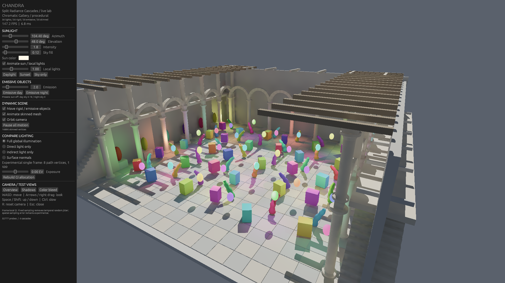

# 1080p optimization and single-frame experiments

Measured 2026-10-26 on Windows, RTX 5070 Ti 16 GB (driver 617.42), Ryzen 9 9950X, CUDA 12.8.1. The scene is the public procedural Chromatic Gallery: 30 animated local lights, 30 moving rigid objects, 30 moving emissive objects, 30 skinned objects, moving sunlight and camera. No Intel Sponza assets or captures are used here.

**Status: the frame-rate goal is reached by the low-sample experiment, but the combined goal of 120 FPS, no temporal accumulation, no noise and unchanged quality is not reached.** Keep that distinction when using these results. The temporal renderer remains the default.



The screenshot illustrates the experimental mode. Its instantaneous UI FPS is not the benchmark average.

## Performance

All cases render at 1920×1080 without a frame cap or VSync. Spatial settings remain unchanged: 10 cm base setting, 131,072 base-probe capacity, four cascades, 32 C0 directions and 6×6 irradiance texels. No geometry, materials, lights or animation groups were removed.

| Mode | Combined frame mean | Mean FPS | Frame p95 | GI total | Geometry updates |
|---|---:|---:|---:|---:|---:|
| Previous public temporal baseline (`5f8c55f`) | 9.2152 ms | 108.52 | 9.6810 ms | 6.3311 ms | 1.8949 ms |
| Optimized default temporal | 8.0524 ms | 124.19 | 8.3874 ms | 6.3986 ms | 0.8660 ms |
| Experimental single frame, depth 8, 1 sample/pixel | 6.6555 ms | 150.25 | 6.9640 ms | 4.8685 ms | 0.9076 ms |
| Experimental single frame, minimum 32 rays/probe | 8.1014 ms | 123.44 | 8.3927 ms | 6.3058 ms | 0.8523 ms |
| Experimental single frame, depth 8, 8 samples/pixel | Not measured | — | — | 19.9261 ms | 0.7839 ms |

GI totals are independently profiled CUDA stream ranges, excluding geometry updates, GBuffer and direct composition. Temporal GI includes its 1.8346 ms history stage (GI main alone is 4.5640 ms). Single-frame GI includes clearing current transport, ray scheduling, tracing, splitting/deposit, cache merge, irradiance and screen interpolation. The event ranges include CPU submission gaps; they are not isolated kernel costs. Do not add separately collected profile means to derive whole-frame FPS. The geometry-only gain does not imply that GI itself accelerated by the same factor.

The scenario benchmark runs seven 600-frame cases, removing each case's first 150 warmup frames and screenshot I/O intervals. The continuous single-frame test runs 3,600 frames, advances the simulation by 1/60 s per frame without sleeping, and excludes the first 120 frames:

- Raw timing including two PNG readback/encoding intervals: mean **6.959 ms / 143.7 FPS**, p95 7.661 ms, maximum 26.413 ms.
- Excluding only those two explicitly flagged intervals: mean **6.949 ms / 143.9 FPS**, p95 7.660 ms, maximum **9.102 ms**. All other outliers remain in the data.
- No nonfinite rendered pixels or ray-buffer overflow. This establishes average performance for this scene and camera sequence, not a guaranteed 120 FPS minimum in every view.

The minimum-ray experiment still falls to 117.07 FPS in the skinned-only scenario. Its combined mean above 120 FPS is not a universal pass.

## Quality and frame independence

Quality is measured on the current-frame linear RGB indirect-light buffer, after the fixed exposure multiplier and before UI or presentation. All candidates in each comparison use the same exposure (0 EV for daylight, +0.7 EV for the night preset). Alpha identifies surfaces, so the sky does not dilute errors. The reference uses **32 samples/pixel and depth 12 in a single frame**, with the same Split RC spatial representation. It is a denser numerical comparison, **not an unbiased path-traced ground truth**. The temporal candidate has 200 stationary frames to converge. `quality.csv` records MAE, RMSE and p95 absolute error.

| Static view | Temporal, frame 200 MAE | Single frame, 1 sample MAE | Minimum 32 rays/probe MAE | Single frame, 8 samples MAE |
|---|---:|---:|---:|---:|
| Overview | 0.0018402 | 0.0042821 | 0.0034682 | 0.0012822 |
| Close-up | 0.0011962 | 0.0024069 | 0.0021492 | 0.0008206 |
| Night, sun/sky disabled | 0.0011919 | 0.0030858 | 0.0027765 | 0.0010499 |

The low-sample mode has approximately 2–2.6× the static MAE of the converged temporal candidate. Eight samples improve these comparisons, but GI alone exceeds the 8.33 ms whole-frame budget. Neither table proves perceptual equivalence or absence of noise. The moving frame-64 comparison favors immediate single-frame response (MAE 0.004463 vs temporal 0.024185); that single motion pose does not cancel the static-quality regressions.

`frame-independence.csv` compares frames 1, 2, 16, 64 and 200 against a cold frame 0. At frames 1/16/64 the test overwrites previous transport with extreme finite values and invalidates old hits before normal frame clearing. Overview outputs are identical. The largest close-up difference is 0.0000584 in an individual channel, with mean 3.11e-9; night maximum is 0.0000126, mean 1.14e-11. These small floating-point reduction differences do not show convergence with elapsed frames. The test found and fixed an octahedral irradiance-border off-by-one that previously read old border values.

Single-frame transport retains spatial allocation across frames for efficiency, but clears weights, fluence and probe quality for current occupied probes. Current merged radiance is rebuilt before consumption. Primary ray assignment is deterministic by pixel rank and hierarchical probe coordinates. Later bounces use independent fixed sample dimensions. There is no prior-frame radiance feedback or temporal denoiser. Nevertheless, finite-depth paths and limited spatial sampling remain approximations; fixed noise is still error.

## Changes and algorithm references

- Batch the 30 skeleton palettes and deformation dispatches. Group each three neighboring skinned meshes into one of ten deforming BLASes; preserve all vertices and original hit/material identities. Keep rigid BLASes immutable and update their TLAS transforms. This follows [NVIDIA's guidance on grouping geometry and acceleration-structure updates](https://developer.nvidia.com/blog/best-practices-for-using-nvidia-rtx-ray-tracing-updated/).
- Cull local lights through a conservative current-frame bitmask grid, then apply the original exact light/shadow calculations in the same order.
- Reuse angular quadrature weights and shared radiance data for irradiance. Preserve input/output angular resolution and Half4 precision; reduction order changes are bounded by the GPU equivalence test.
- Stop dynamic-history region scans after the group is already discarded.
- Keep the [Split RC paper's](https://arxiv.org/abs/2607.20384) hierarchy, ray splitting and spatial interpolation. The paper's temporal multibounce feedback is distinct from single-bounce frame-local transport. The experiment replaces that feedback with finite paths computed during the current frame; it is not an equivalent no-cost switch.
- Try extra rays for undersampled probes (inspired by the paper's fixed-budget discussion), exact integer work allocation and compact work queues. A separate `--frame-cache` experiment shares secondary transport within the same frame, but has not demonstrated equivalent quality at the target cost. Both remain optional experiments.

## Reproduction

Run `setup-lighting-lab.ps1` first on a fresh checkout. Use the repository's pinned toolchains and launcher; GPU kernels compile at runtime. Run GPU jobs serially and close interactive instances before building or measuring.

```powershell
./run-lighting-lab.ps1 -Test
./run-lighting-lab.ps1 -Gallery -FullHD -Benchmark -Output .local/default-benchmark
./run-lighting-lab.ps1 -Gallery -FullHD -ProfileGpu -Output .local/default-profile
./run-lighting-lab.ps1 -Gallery -FullHD -SingleFrame -Benchmark -Output .local/single-benchmark
./run-lighting-lab.ps1 -Gallery -FullHD -SingleFrame -ProfileGpu -Output .local/single-profile
./run-lighting-lab.ps1 -Gallery -FullHD -SingleFrame -StressTest -Output .local/single-stress
./run-lighting-lab.ps1 -Gallery -FullHD -SingleFrame -MinProbeRays 32 -Benchmark -Output .local/adaptive-benchmark
./run-lighting-lab.ps1 -Gallery -FullHD -SingleFrame -Samples 8 -ProfileGpu -Output .local/high-profile
```

For raw quality capture after building, set the CUDA runtime path as the launcher does. The following captures use overview (`--view 0`); repeat with `--view 2` for the close-up, and add `--emissive-night` for night. Add `--quality-motion --quality-frames 64` to every capture in a motion comparison and compare matching frame 64 files.

```powershell
$env:PATH = "$PWD/.local/cuda/bin;$env:PATH"
./target/debug/lighting_lab.exe --gallery --1080p --single-frame --quality-check --indirect-only --view 0 --output .local/q-single
./target/debug/lighting_lab.exe --gallery --1080p --quality-check --indirect-only --view 0 --output .local/q-temporal
./target/debug/lighting_lab.exe --gallery --1080p --single-frame --path-depth 12 --samples 32 --quality-check --quality-frames 1 --indirect-only --view 0 --output .local/q-reference
# Requires Python and NumPy. Values are linear radiance, not screenshot colors.
python tools/compare-gi-quality.py .local/q-reference/frame-000.rgba32f .local/q-single/frame-000.rgba32f .local/q-temporal/frame-200.rgba32f
```

All 17 tests passed: four library/scene tests, six geometry tests, one history test, three lighting tests and three GI tests. New coverage includes grouped BLAS identity and batched skinning across 12 poses, conservative light-grid equivalence across light moves/range changes, weighted ray deposits, angular quadrature equivalence and poisoned irradiance borders. Exact large raw captures remain local; compact configuration, timing and quality data are included in this directory.
