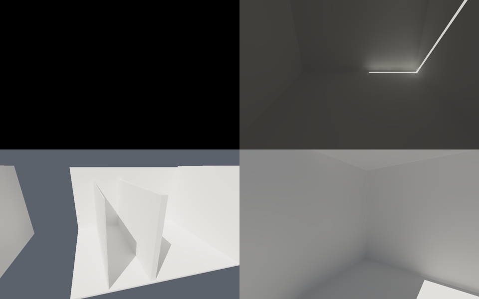

# 间接漫反射改造与验证（2026-10-26）

> 历史记录：本目录对应第一批基础改造及其 `f1373182…` 二进制，不包含后续的漫反射重建和自由相机焦点修正。当前收尾、用户效果确认和实机交互记录见 [diffuse-motion](../diffuse-motion/README.md)。本目录的 GPU 时间不能作为最终版本性能。

从干净的 `bcd96d48e6f47a76e3fd6b33c264468b80f8b680` 基线重新实现。`git fetch origin` 后远端仍是该提交；没有应用交接 ZIP，也没有把交接文档中的历史数据作为新实现的结果。

本轮范围是 Lighting Lab 的间接漫反射。没有增加间接高光、GGX、reservoir 或 ReSTIR；PICA 转换、PBR/cutout 扩展和 RobotExpressive 资源接入留待后续。原研究 viewer 的实验功能不属于本轮验收。

## 已实现

- 几何运动只降低可能受 swept bounds 影响的方向组置信度，几何半衰期 100 ms；同步缩放权重和 fluence，保持归一化辐亮度及已合并 radiance。按方向采样密度限制到约八帧、最低 16 个样本；仍丢弃运动区域内失效的 secondary hits。无几何运动导致的全局快速衰减。
- 改光单独使用 `LightingResponse`。方向编辑逐渐恢复；能量编辑保留 150/500 ms 的单/多反弹排能窗口，能量置信度半衰期 25 ms。手动编辑期间增加到四个主 GI 样本，自动动画保持原来的一个样本；忽略 UI 色彩往返中的微小浮点变化。
- RC 合并使用八个固定邻居槽；缺失项权重为零，不再根据分歧 hash 查询后的 active warp mask 压缩索引。
- hash 插入、重建和查询有有限探测次数。`try_reset_table` 报告失败，`recover_probe_capacity` 先回收旧视角，再逐步提高 GPU singleton 中的空间 LOD；primary 和 secondary 都参与重试。仍失败时停止本帧 GI 消费、保留直接光；连续两帧成功后恢复显示。
- 全部相关射线使用厘米制 `max(0.001, max(abs(position))*8*EPSILON)` 偏移。新增白房间四个机位：4 cm 封闭壳、8 cm 顶部狭缝、2/12 cm 实体隔墙和开放屋角；统一 0.8 漫反射。
- GBuffer kernel 由 `CoreData` 实例持有。正常启动由无 GPU context 的 supervisor 管理场景 worker，等待退出后才启动下一个；支持 Gallery、White Room、Courtyard，以及本机具备资产时的 Sponza。
- 自由相机支持 WASD、Q/E、Shift/Ctrl、右键/F 看向、F1 隐藏面板；手动输入停止 orbit，Windows 失焦释放输入。
- 质量采集保存线性 RGBA32F、相机 JSON、完整参数、容量状态；Courtyard 另跟踪移动方块上固定重心坐标的表面点，避免把不同屏幕位置直接相减。

## 复现

```powershell
./run-lighting-lab.ps1 -BuildOnly
./run-lighting-lab.ps1 -Test
python -m pip install numpy Pillow
python tools/validate-diffuse.py --capture --output .local/diffuse-acceptance/final-v3
```

采集串行进行，期间不能重建 EXE 或修改实现、测试、工具。已有目录不覆盖；`--reuse` 要求二进制、源文件指纹及参数 manifest 完全匹配。大体积帧、日志及 CSV 位于 `.local/`，精简报告保存在 [validation.json](validation.json)。图像比较统一使用固定曝光、Reinhard + gamma 2.2；交互显示仍用 AgX。

```powershell
./run-lighting-lab.ps1 -WhiteRoom -View 0
./run-lighting-lab.ps1 -Courtyard -GeometryOnly
./run-lighting-lab.ps1 -Courtyard -GeometryOnly -SingleBounce
./target/debug/lighting_lab.exe --scene-worker --white-room --roam-test --roam-frames 2400 --probe-budget 1024 --output .local/capacity
```

直接启动 EXE 前将 `.local/cuda/bin` 加入 PATH，保留 `target/debug` 下的 Luisa DLL。`--scene-worker` 为诊断入口；日常场景切换应保留 supervisor。

## 测量的含义与限制

当前候选的 EXE SHA-256、源文件指纹、硬件/驱动、固定依赖、每项完整命令、失败列表与整帧时序见机器可读报告。GPU/CPU 回归套件共 26 项。首个候选关灯后未达标的结果保留在 [initial-failure.json](initial-failure.json)，其中额外报告了排除天空后的表面残余能量。

收敛参考为同一渲染器在运动停止的相同姿态清空 transport、再运行到第 600 帧的结果。它不是路径追踪真值。移动方块的逐帧表面差还包含旋转造成的真实光照变化；采集成功或平均误差通过，都不能证明任意相机运动零闪烁。

Gallery benchmark 覆盖 static / rigid / skinned / sun / camera / combined / settled 七组；压力测试为 3,600 帧。CSV 的 mean/p95 是完整帧间隔，不能作为 GI GPU 时间，也不能引用旧的 RTX 5070 Ti 历史优化收益作为本轮提速。画面质量与帧时间尖峰仍需要持续验收。



## 最终候选结果

EXE SHA-256：`f1373182a3241cb2cd9fa47413cdbfbdb09e51e41ba343874aa6ab851f3fb764`。硬件：NVIDIA GeForce RTX 5070 Ti, 617.42, 16303 MiB。

| 检查 | 本轮结果 |
| --- | --- |
| GPU/CPU 回归 | 26 项通过 |
| 自动采集与计算 | 19 项检查通过；不等于完整 release 放行 |
| 封闭白房间 | 第 200 帧线性 RGB 最大值 0 |
| 关灯 40 帧后的表面 GI 残留 | 0.295%（门槛 1%） |
| 单反弹，停止后同姿态收敛显示 MAE | 0.001335 |
| 多反弹，停止后同姿态收敛显示 MAE | 0.001040 |
| 1,024 probe / 2,400 帧漫游 | 两次恢复、未跳过帧，最终 LOD bias 3 |
| 256 probe 的持续不足 | 17 帧明确跳过 GI，直接光输出有限 |
| Gallery / 1080p / 3,600 帧压力 | 无非有限输出、无射线队列溢出；整帧均值 9.720 ms、p95 11.008 ms |
| Courtyard / 1080p / 漫反射 GI 含动态历史 | 200 帧预热后测 240 帧；GPU 均值 2.9209 ms、p95 3.4040 ms |

GPU 分项、命令和人工验收限制见 [补充记录](supplementary-validation.json)、[GPU passes](gpu-passes.csv) 和 [GPU summary](gpu-summary.csv)。完整场景时序见 [Gallery](gallery-timings.csv) 与 [Courtyard](courtyard-timings.csv)。两轮以上完整帧时间存在波动，不能据此宣称同质量提速。

F1 的实机测试出现截图选择覆盖层，未计为通过；完整键鼠/失焦矩阵及任意相机运动的局部闪烁/拖影仍需人工验收。移动表面点的 RMS 含真实光照变化，不作为零闪点通过依据。
