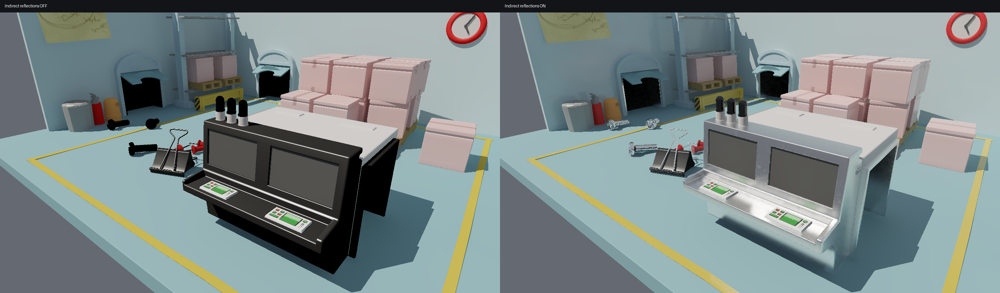

# PICA: bounded reflections sharing the RC field

This replaces the default PICA full-resolution adaptive reflection path. The
previous version is preserved by `-SpecularQuality`. The initial checkpoint
`bf3348fa00a08a18ecd3d62622bfc82e568c5639` was pushed to `origin/main` before this
work. No LTC or ReSTIR is used.

At 1920×1080 on an RTX 5070 Ti, the difficult near-view combined-motion test
improved from **18.20 to 55.32 FPS**. The new metal-console view reaches
**68.83 FPS static / 64.12 FPS combined motion**. These measurements retain the
four-ray glossy path shown in the images below.



[Wider console comparison](console-close-comparison.png) ·
[Other side](console-left-comparison.png) ·
[Reflection layer, original exposure](console-detail-reflections.png) ·
[Camera/light motion against the reference](quality/console30/combined/comparison.mp4)

The expensive part of the old implementation was the amount of work, rather
than scene triangle count: up to 128 primary glossy samples per newly exposed
pixel, another reflection segment per sample, and up to 64 primary rays to
refresh diffuse RC. Close surfaces occupy many pixels and lose history when
the camera moves. Optimizing dispatches alone does not bound this cost.

## Transport and reconstruction

* Default reflection dimensions are half the image width and height. Glossy
  pixels with roughness 0.08–0.60 use four GGX VNDF queries. Self-normalized
  weights keep constant incident radiance constant at this low budget; a
  split-sum table supplies the surface's material response. This is biased.
* Below roughness 0.08, the dominant reflection direction is evaluated at full
  resolution. Perfect mirrors retain one additional deterministic continuation
  when the reflected surface is glossy. Unrepresented thin surfaces get a
  bounded full-resolution query instead of borrowing a background pixel.
* Roughness 0.45–0.60 blends toward RC. The RC angular field is convolved once
  per occupied probe into three roughness levels and 6×6 octahedral directions
  with folded borders. All pixels share this result. A single visibility ray
  only approximates visibility of a broad cone; this is not exact occlusion.
* Secondary diffuse lighting reads the existing irradiance atlas. Broad, weak
  dielectric secondary lobes share that angular approximation. Other secondary
  glossy lighting uses the directional prefilter, with cascade fallback only
  when probe support is incomplete. Additional recursive glossy sampling is
  avoided except for the bounded perfect-mirror continuation.
* Diffuse RC refresh is capped at eight samples per pixel, including newly
  exposed pixels; stable base sampling remains two. Explicit diagnostic sample
  overrides are honored. The associated work queue reserves the bounded size.
* Reconstruction separates incident radiance from the full-resolution BRDF.
  It uses object, position, normal and roughness guides, a spatial pass,
  reprojected history, and full-resolution upsampling. Sharp reflections keep
  reflector checks. Stochastic glossy samples do not invalidate history merely
  because the randomly sampled reflector changes.
* The full-resolution reflection history limits accepted perceptual RGB changes
  to 0.08 per frame. The final beauty image has a separate short perceptual TAA
  (35% current, 65% validated history). It has no brightness-step clamp. Geometry
  changes, camera cuts, lighting jumps, and display-mode changes invalidate the
  relevant histories. New surfaces bypass history. The final filter is needed
  because separately stable reflection and direct-light layers can still jump
  when composed during moving highlights.

An intermediate attempt handed roughness above approximately 0.12 entirely to
RC. It was faster but erased visible reflected shapes, and was rejected after
the user's screenshot feedback. None of its performance numbers describe this
four-query implementation.

## Reproduce

```powershell
./run-lighting-lab.ps1 -PicaPica -FullHD -View 3 -Static
# View 3 is the new metal-console close-up; the panel calls it Reflections.
./run-lighting-lab.ps1 -PicaPica -FullHD -View 3 -Static -SpecularQuality
./run-lighting-lab.ps1 -PicaPica -FullHD -View 3 -Static -ReflectionScale 4

python tools/capture-pica-reflections.py --output .local/reflection-comparison
python tools/profile-pica-isolated.py --output .local/reflection-profile --camera-dolly 42 --simulation-fps 20 --cases static camera combined combined-no-specular
python tools/validate-specular-motion.py --capture --output .local/reflection-motion --view 3 --cases static camera sun combined fast-stop --simulation-fps 30 --frames 260 --tail 140 --reference-exact-feedback
```

`-ReflectionScale 1|2|4` controls the intermediate image, not the final image.
`-RcUpdateSamples N` controls the diffuse refresh cap. `-SpecularSamples` applies
to the old quality path; 128 samples or `--specular-reference` selects it.

## Evidence and limitations

Measured on 2026-10-27, Windows, RTX 5070 Ti 16 GB, driver 617.42. Albor was
closed. WDDM engine samples recorded only `dwm` at approximately 7% before the
runs; no other rendering workload was active. Runs are sequential, exclude 200
warmup frames, and measure 120 frames. FPS is actual wall-clock throughput
including presentation. Stage durations are CUDA event timings. The development
build uses the repository's optimized profile.

| 1080p case | Old `bf3348f` FPS | New FPS | New P95 frame, ms | New reflections, ms |
|---|---:|---:|---:|---:|
| Near, static | 27.54 | 57.76 | 17.94 | 6.13 |
| Near, camera | — | 60.12 | 18.83 | 5.41 |
| Near, camera + sun | 18.20 | 55.32 | 20.18 | 5.43 |
| Near, camera + sun, reflections off | — | 78.73 | 14.13 | 0.00 |
| Console, static | — | 68.83 | 15.15 | 4.96 |
| Console, camera + sun | — | 64.12 | 18.76 | 4.66 |

Near uses view 1, dolly 42, and a deterministic 20 Hz pose/history clock for both
versions. Console uses view 3 and 60 Hz. These simulation rates are not FPS
limits. Old/new near results use the same replay. The old near combined
reflection cost was 28.09 ms and total P95 was 69.24 ms. Both reflection work
and RC refresh work are reduced; this is not an equal-quality comparison.
The [performance directory](performance/) contains per-frame CSVs, stage ranges,
binary/scene hashes, command lines, GPU telemetry and WDDM process inventories.

All **43 Rust tests** pass. Material checks verify the authored factors and six
textures; the Python motion/reprojection checks also pass. The constant-field,
octahedral seam, cold probe, odd resolution (scales 1/2/4), history reset,
fixed sample limit and finite fade checks exercise the new implementation.

**790 evaluated frames:** five console sequences at 320×200 / 30 Hz, 140 frames
each, plus 90 near-view combined frames at 640×360 / 20 Hz. Every sequence has
zero detected bright/dark impulses in full, specular, base and rough-specular
channels. Console references were freshly captured with the tested binary.
The near reference reuses the unchanged dense path's earlier immutable capture;
the receipt identifies its source and binary. The reflection mean energy ranges
from approximately −11.1% (console static) to −1.8% (near combined) relative to
that reference. Full-image mean display error is 0.47–1.59% across these cases.
Exact metrics and original capture receipts are in [quality/](quality/).

The attached on/off images are separate actual renders at the same camera pose
and exposure. Their reflection-only images use the same tone map and exposure;
they are not contrast-boosted differences. Materials and textures are unchanged.
The [manifest](manifest.json) identifies the tested executable and source files;
[screenshot receipts](screenshots-receipt.json) record each actual on/off command.

The motion checker compares with a 128-sample raw hybrid reference using the
same finite secondary transport. It is not full path-traced truth. It detects
unsupported changes greater than 10% display luminance on reprojectable surfaces
using the same-surface reference neighborhood. Disocclusions are excluded.
`base-lighting` is captured independently before final composition; subtracting
a pre-composition reflection from a temporally filtered final image would not
measure that layer correctly. Detector thresholds and correspondence rules
are unchanged.

Expect softer reflected detail, reduced secondary caustics, approximate broad
visibility, and temporal response lag. The final TAA has an exponential time
constant of about 2.3 frames; 90% of a sustained step arrives after about six
frames when history remains valid. Reflection history may add more delay.
These choices favor stable real-time images and do not preserve reference
quality. Passing a bounded motion sequence does not prove that every possible
camera/light edit is artifact-free.

The design is informed by [AMD's two-level radiance caching reflection paper](https://gpuopen.com/download/SA2023_RealTimeReflection.pdf)
and [NRD's integration guidance](https://github.com/NVIDIA-RTX/NRD/blob/master/README.md).
Neither implementation is incorporated as a dependency.
