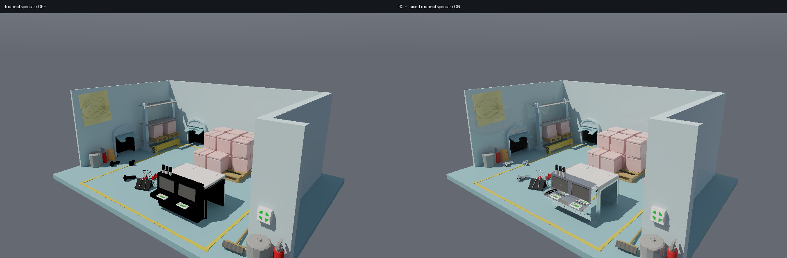
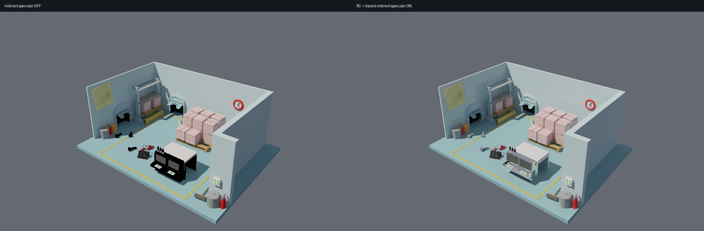

# PICA PICA hybrid indirect specular — 2026-10-27

**Historical, superseded asset conversion.** The original importer ignored
active Glossiness channels, incorrectly turning 11 materials into perfect
mirrors. These images and the 4.85 ms timing use that incorrect material setup
and are not current visual or performance acceptance evidence. The conversion
has been corrected and is covered by `tools/test-pica-materials.py`.
See the [motion validation record](../motion/README.md) for current results.

The imported scene has 145 source mesh objects, 170 material meshes, 76,300
triangles, 28 materials and six textures. Geometry, material values and images
are by **SEED / Electronic Arts**, licensed under **CC BY-NC 4.0**.
[Source, attribution and conversion changes](../../../resources/pica-pica/SOURCE.md).
Captures in this directory use those assets and retain the same attribution.

## Run and compare

```powershell
./tools/setup-pica-pica.ps1  # Already imported locally; requires Blender 4.2+.
./run-lighting-lab.ps1 -PicaPica -FullHD -View 1 -Static
./run-lighting-lab.ps1 -Test
python tools/validate-hybrid-specular.py --capture  # numpy and Pillow required
```

The panel exposes **Indirect reflections** and **Reflections only**. Switching
reflections off skips their GPU passes and invalidates their history. View 0
shows the entire diorama; view 1 is the closer workstation view. WASD and
right-drag move the camera; Tab hides the panel. `-SpecularSamples 8` increases
the default four samples per pixel.





These comparisons come from actual GPU linear output. Left is the full image
minus its separate indirect-specular buffer; right is the full image. Both use
the same frame, direct lighting, diffuse GI, Reinhard tone mapping and gamma
2.2 at 0 EV. They are not renders from different lighting presets.

## Implemented transport

- Base colors decode sRGB once; roughness and metalness remain linear. Material
  factors are restored from the author's published material channels by exact
  name. Custom normals are retained, and decals use alpha masks consistently
  for camera, reflection and shadow rays. The source has no enabled normal maps.
- GGX visible-normal BRDF samples trace first-segment visibility from the
  shaded surface. Roughness 0.45–0.60 blends traced shading into directional RC
  radiance outside the near probe footprint. Lower roughness traces the hit
  shading, and zero roughness uses the deterministic mirror direction.
- Reflection hits use direct lighting, emission and diffuse RC, plus one
  additional glossy continuation or rough RC integration. Numerical BRDF
  integration is implemented; LTC and ReSTIR are not enabled.
- Reconstruction checks surface identity, depth, normals, roughness and
  reflection distance. Smooth surfaces also validate a deterministic reflected
  object/position guide. Lighting changes discard history; camera motion reduces
  accumulation. Exact mirrors skip spatial blurring.

## Validation

All **35 Rust CPU/GPU tests passed**. The four added tests check GGX sampling
against independent hemisphere integration and mirror energy, alpha-cutout
visibility and metallic diffuse suppression, offscreen reflection hits, and
the actual reflection/reconstruction pipeline with emission and invalid history.

The six capture cases in [validation.json](validation.json) cover a near view,
overview, static view, higher-sample traced reference, rotating camera and
lighting step. All recorded output is finite, with zero negative specular
values, zero probe-capacity recoveries and zero skipped GI frames.

For the 480×300 static view, averaged over the last eight frames:

| Comparison against traced reference | Value |
| --- | ---: |
| Relative mean indirect-specular energy | −1.82% |
| Scene-linear specular MAE | 0.000722 |
| Tone-mapped specular MAE, normalized to [0, 1] | 0.001957 |

The reference uses 64 samples/pixel × eight raw frames, traces the first
reflection segment, and retains the same finite secondary transport. These
numbers measure this view against that reference, **not error against full
path-traced ground truth**. The manifest records the capture binary and scene
hashes. These captures predate the subsequent motion-stability changes.

At 960×600 in the static near view, mean raw temporal variance was 7.76e−5 and
reconstructed variance was 7.63e−7. This reduction alone does not prove image
accuracy. The rotating and relit captures are diagnostics; temporal variance
during camera motion also contains real image changes.

## GPU cost

NVIDIA GeForce RTX 5070 Ti, 1920×1080, view 1, static camera and geometry,
four specular samples/pixel, 200 warmup frames and 120 measured frames.

| GPU event range | Mean | p95 |
| --- | ---: | ---: |
| Reflection trace | 4.347 ms | 4.451 ms |
| Reflection reconstruction | 0.506 ms | 0.541 ms |
| Reflections total | **4.853 ms** | **4.982 ms** |
| Diffuse GI including history | 9.060 ms | 9.298 ms |

[Per-pass measurements](passes.csv) and [per-frame aggregate statistics](summary.csv).
Event ranges include submission gaps. Reflection cost excludes diffuse GI,
geometry, GBuffer, direct composition, UI and presentation; it is not a total
frame time. The sum's p95 is computed from per-frame sums, not by adding stage
percentiles. Profiling command after building:

```powershell
$env:PATH = "$PWD/.local/cuda/bin;" + $env:PATH
./target/debug/lighting_lab.exe --scene-worker --pica-pica --1080p --view 1 --static --profile --profile-frames 120 --specular-samples 4 --output .local/pica-profile
```

## Limits of this version

RC angular/spatial interpolation remains biased; high-frequency highlights and
motion can retain noise or lose detail. The transport truncates glossy paths,
so it does not reproduce all mirror chains or caustics. Glass uses an opaque
reflective approximation; transmission/refraction and the original HDR
environment and ShaderFX are absent. The PICA import is static. These results
are a working hybrid reflection baseline, not a claim of zero flicker or full
physical accuracy.
