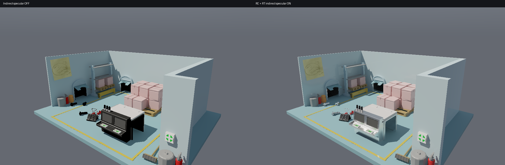

# PICA PICA 动态间接高光验证 · 2026-10-27

> 本页保留性能优化前的连续帧记录。优化后的二进制已重新录制全部八组轨迹，
> 结果与实际帧时间见 [当前性能与质量复查](../optimized-v2/README.md)。

修正材质后，六条 320×200 轨迹和两条 960×600 轨迹的完整画面、单独反射层，
在下述检测阈值内均未检出异常亮跳或暗跳。结果限定于记录的轨迹、分辨率和阈值；
不是对所有视角和所有灯光变化的保证。

## 修复内容

- 修正之前的导入错误：作者有 13 种材质使用 Glossiness 通道，其中 11 种
  非零粗糙度曾被错误地设成完全镜面。现在按启用的通道转换
  `roughness = 1 - glossiness`，核对了全部 28 个材质的颜色、金属度和粗糙度，
  以及 6 张贴图、贴花遮罩。早期错误材质的截图和 4.85 ms 数据不作为当前验收依据。
- 采用带随机数字移位的四维 Sobol 序列，两次反射各用两个维度。
  增加预算时仍使用同一个序列的前缀；没有使用 ReSTIR。
- 采样分配和重建共用同一套历史有效性判断。新显露区域、当前估计与有效历史
  明显不符、或遇到罕见高能量路径时，当帧补至 128 样本。
  常规预算 16，薄物体／掠射角至少 32，光滑金属至少 64。
  完全确定的镜面路径只计算一次。
- 直接照明、发光和确定的镜面细节与 RC／随机路径分量分离。
  RC 分量即使经完全镜面反射也被标为估计量；仅依赖 RC 的精确镜面保持很短的
  历史，并跳过额外空间模糊，避免反射纹理和遮挡边界被抹黑。
- 连续转光和移动相机使用约四帧历史；明显跳变、能量编辑或几何变动会拒绝历史。
  稳健空间权重和当前样本方差限制抑制错误的亮点扩散。
- 粗糙反射后的次级 GGX 使用路径正则化，缓和难以采到的尖锐间接焦散；
  直接看到的材质和纯镜面链不做这项处理。这是明确的有偏近似，
  可用 `--no-specular-regularization` 关闭。
  [方法背景：PBRT 路径正则化](https://pbr-book.org/4ed/Light_Transport_I_Surface_Reflection/A_Better_Path_Tracer)。

传输仍是有限深度混合：粗糙度 0.45–0.60 在近场以外渐变到方向 RC，
第一段可见性保持射线追踪。粗糙的第一反射用每条路径的一次后续采样，
避免每条射线内部再次做整套方向积分；精确镜面遇到粗糙次级表面时仍做 RC 方向积分。
玻璃目前按不透射的反射表面处理。

## 连续帧结果

候选和参考采用同一相机、光源、曝光与有限深度传输。参考为每帧 128 个原始样本，
不做反射重建，不是完整路径追踪真值。前三条复测复用了相同正确材质、相同传输的
已保存参考；实际二进制哈希、场景哈希和参数见 receipts。

| 分辨率 | 轨迹 | 完整画面亮／暗事件 | 反射层亮／暗事件 |
| --- | --- | ---: | ---: |
| 320×200 | 静止 | 0 / 0 | 0 / 0 |
| 320×200 | 相机平移与转动 | 0 / 0 | 0 / 0 |
| 320×200 | 连续转光 | 0 / 0 | 0 / 0 |
| 320×200 | 相机与光源同时变化 | 0 / 0 | 0 / 0 |
| 320×200 | 快速转光后停止 | 0 / 0 | 0 / 0 |
| 320×200 | 移开再返回 | 0 / 0 | 0 / 0 |
| 960×600 | 连续转光 | 0 / 0 | 0 / 0 |
| 960×600 | 相机与光源同时变化 | 0 / 0 | 0 / 0 |

320×200 每段分析最后 190 个连续帧；960×600 每段分析最后 90 帧，
共 1320 个候选评估帧。检测先按位置、法线与相机重投影，再找超过 0.10
显示亮度的跳变；只有同帧参考的同表面 3×3 邻域也不支持该变化时，才计为异常。
计数单位是像素事件，所有加载的浮点输出均检查有限性。所有轨迹均为零探针容量恢复、零跳过 GI 帧。
共同存在于候选和参考中的几何边缘／直接高光混叠不属于这个间接反射异常指标。

[六条轨迹数据](after.json) · [高分辨率数据](large.json) ·
[同材质补采样前对照](before-adaptive.json) ·
[低分辨率运行凭据](after-receipts.json) · [高分辨率运行凭据](large-receipts.json)

## 画面与视频



[移动相机](camera.mp4) · [连续转光](sun.mp4) ·
[相机与光源同时变化](combined.mp4) · [移开再返回](return.mp4)

视频左侧是候选，右侧是 128 样本原始参考。模拟时间步固定为 60 Hz，
视频每隔一帧取样并以 30 fps 播放；这些视频不是实时帧率测量。

经用户授权关闭另一个项目的 `Albor.Runtime.exe` 后，已完成
[同一二进制的独占 GPU 复测](../performance/README.md)：RTX 5070 Ti / 1080p，
静止与相机、光源同时运动的间接高光分别为 79.08 / 173.33 ms，
当前性能未达到实时要求。受 Albor 干扰的早期性能采样不作为验收依据。

## LTC 的位置

当前实现使用数值 GGX 积分，**尚未接入 LTC**。LTC 可将拟合后的 BRDF
在方向区域上积分；结合当前管线，我判断它适合用来减少中高粗糙度 RC 分支的
采样噪声和逐像素追踪成本。需要按 RC 方向格的立体角来计算权重，
并继续处理缓存有效性与可见性。RC 的空间／角度分辨率和 LTC 拟合误差仍会限制精度。
低粗糙度和镜面继续保留 RT 与相应重建。
[原始 LTC 研究](https://eheitzresearch.wordpress.com/415-2/)。

## 复现

```powershell
./tools/setup-pica-pica.ps1
python tools/test-pica-materials.py
./run-lighting-lab.ps1 -Test
python tools/test-specular-motion.py
python tools/validate-specular-motion.py --capture --output .local/pica-motion-check
python tools/validate-specular-motion.py --capture --output .local/pica-motion-large-check --cases sun combined --width 960 --height 600 --frames 210 --tail 90
./run-lighting-lab.ps1 -PicaPica -FullHD -View 1 -Static
```

36 项 Rust CPU/GPU 测试通过；另有导入参数检查、重投影数值一致性检查和
两项既有漫反射对应关系检查。脚本需要 numpy、Pillow 和 ffmpeg。
原始连续浮点帧保留在忽略的 `.local` 中，仓库仅保存统计、凭据和预览。

PICA PICA 几何、材质及贴图：**SEED / Electronic Arts，CC BY-NC 4.0**。
本目录渲染图像和视频保留该署名。
[来源、许可及转换说明](../../../resources/pica-pica/SOURCE.md)。
