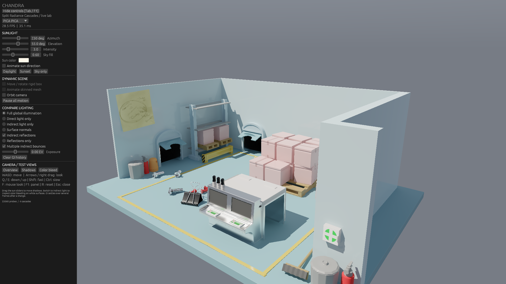

# PICA PICA 性能修复与连续帧复查 · 2026-10-27

> 历史版本记录；当前短射线任务版本与收尾验证见 [optimized-v2](../optimized-v2/README.md)。

修复了移动相机时全屏提高漫反射采样的问题，并优化了透明遮罩遍历、
反射命中着色和自适应射线调度。关闭高光后，相机运动已不再触发全屏 8／16 样本。
开启间接高光的 1080p 性能明显改善，但仍未达到 60 FPS。

## 为什么关闭间接高光后移动相机仍掉帧

漫反射 GI 是独立的一条路径。此前相机移动把普通像素基础预算从 2 提到 8，
快速移动时提到 16；局部历史失效又会追加到 16／32／64。现在基础预算为 2，
照明或几何变化时为 4，只在历史和表面支持不足的位置补采样。
另外修复了四帧历史经双线性重投影后略低于 4、被误判为未收敛的问题。
局部新增可见区域仍然需要补采样，因此不能保证运动与静止帧时间完全相同。

## 同一版本的性能

RTX 5070 Ti 16 GB，驱动 617.42，1920×1080，PICA 视角 1，
28 个正确材质、6 张贴图，多次间接反弹。基础高光预算为 4；
薄边、金属、历史失效和不确定估计按需要补至 16／32／64／128。
本次保留完整分辨率的反射，没有采用半分辨率或动态分辨率。
每组预热 200 帧，随后记录 120 帧，固定模拟步长 1/60 秒，无帧率上限。

| 条件 | 间接高光 | 平均帧时间 ms | 帧时间 P95 ms | FPS | GI 含历史 ms | 间接高光 ms |
| --- | --- | ---: | ---: | ---: | ---: | ---: |
| 静止 | 关 | 7.93 | 8.36 | 126.0 | 6.44 | 0.00 |
| 静止 | 开 | 31.92 | 32.54 | 31.3 | 6.52 | 23.80 |
| 仅相机移动 | 关 | 12.85 | 15.18 | 77.8 | 11.29 | 0.00 |
| 仅相机移动 | 开 | 50.91 | 56.66 | 19.6 | 11.32 | 37.91 |
| 仅光源转动 | 关 | 8.67 | 9.08 | 115.4 | 7.19 | 0.00 |
| 仅光源转动 | 开 | 32.25 | 33.13 | 31.0 | 7.18 | 23.50 |
| 相机与光源同时运动 | 关 | 14.62 | 17.04 | 68.4 | 13.09 | 0.00 |
| 相机与光源同时运动 | 开 | 51.57 | 57.66 | 19.4 | 13.08 | 36.79 |

FPS = 1000 / 平均实际帧间隔，包含主机与呈现开销；不是应用 UI 的平滑 FPS。
阶段耗时为 CUDA event 区间，可能包含主机提交间隙，不等于纯 kernel 耗时。
[每帧时间、阶段 CSV、参数、哈希和 GPU 遥测](profile/static/receipt.json)按工况保存在 profile 目录。

优化前同一场景的反射阶段静止／同时运动为 79.08／173.33 ms，
现在为 23.80／36.79 ms。
旧数据使用基础预算 16，新版基础预算 4 并保留局部高预算，因此这些提升同时包含
执行优化和采样分配调整，不能全部归因于硬件遍历。
[旧版独占 GPU 基线](../performance/README.md)的 FPS 是 UI 平滑读数，不能与本表作为同口径平均 FPS 直接比较。

测试前已按用户授权正常关闭 Albor.Runtime.exe。全程顺序执行；
[逐进程 GPU 检查](gpu-process-check.json)和测试前后遥测未发现显著的竞争 GPU 工作负载。
桌面合成、Codex 与浏览器存在低占用，不能称为绝对零后台 GPU 活动。

## 实现变化与代价

- 只有使用 alpha mask 的实例触发透明度回调；普通三角形走硬件不透明遍历。
  阴影查询用 any-hit，避免全场景最近交点查询及重复追踪。
- 次级漫反射读取现有探针法线辐照度图集，替代每次命中的 32 方向积分。
  这是法线插值近似；常量场测试保持能量，方向场误差有数值检查。
  `--specular-exact-diffuse` 保留旧积分以供比较。
- 镜面确定性部分只算一次，普通像素基础 4 样本；有成熟历史且空间支持充分的
  光滑金属为至少 16，否则为至少 64，新显露金属仍保留 128。
  降低新显露金属预算的试验出现闪黑，已经撤回。
- 漫反射补采样分成最多 8 射线的任务；反射高预算像素先压缩到队列，
  再按 32 射线独立执行，单独计算阶段合并，并按需延长至 128。
  保持相同 Sobol 前缀、接受射线数和归一化。支持 `--diffuse-serial`、
  `--specular-serial` 对照。OptiX 跟踪前后不保证同组线程关系，未采用跨光追的 warp 求和。
- 反射批次暂存约 704 字节／像素，1080p 额外约 1.36 GiB；
  本轮 1080p 整卡显存遥测约 5 GiB。尚未验证 4K 的显存与性能。

## 连续帧质量

候选与 128 样本原始参考都由本次同一二进制重新录制。
参考使用相同有限深度混合传输与辐照度图集，不是完整路径追踪真值。
六条 320×200 轨迹各分析最后 190 帧；两条 960×600 轨迹各分析最后 90 帧，
共 1320 个候选评估帧。全部加载的浮点数据有限。

| 分辨率 | 轨迹 | 完整画面亮／暗事件 | 反射层亮／暗事件 | 反射平均能量相对参考 |
| --- | --- | ---: | ---: | ---: |
| 320×200 | static | 0 / 0 | 0 / 0 | -3.11% |
| 320×200 | camera | 0 / 0 | 0 / 0 | -2.49% |
| 320×200 | sun | 0 / 0 | 0 / 0 | -1.61% |
| 320×200 | combined | 0 / 0 | 0 / 0 | -2.02% |
| 320×200 | fast-stop | 0 / 0 | 0 / 0 | -0.49% |
| 320×200 | return | 0 / 0 | 0 / 0 | -3.01% |
| 960×600 | sun | 0 / 0 | 0 / 0 | -1.49% |
| 960×600 | combined | 0 / 0 | 0 / 0 | -0.42% |

异常指标：位置／法线重投影后，显示亮度跳变超过 0.10，且同帧密集参考的
同表面 3×3 邻域不支持该跳变。计数为像素事件，不是帧。
结果只适用于记录的轨迹、分辨率和阈值；直接高光与几何边缘的共同混叠不计入此指标。
高光重建仍有小幅能量偏差，不能称作与参考完全相同。

[完整质量数据](quality.json) · [二进制与场景凭据](quality-receipts.json) ·
[相机运动视频](motion/low/camera/comparison.mp4) · [相机和光源同时运动](motion/large/combined/comparison.mp4)

视频固定 60 Hz 模拟，每隔一帧取样并以 30 FPS 播放，不是实时帧率证据。
38 项 Rust CPU/GPU 测试通过，包括粗糙金属／非金属、多帧历史、非二次幂采样的
分批与串行对照；材质检查、六通道重投影检查和两项既有漫反射检查通过。

数值 GGX / RC / RT 方案已实现；**LTC 和 ReSTIR 均未接入**。
玻璃仍为不透射的反射近似，原作者 HDR 环境未复现。
主要剩余性能瓶颈是反射路径追踪与命中着色；本报告不把开启高光的低帧率标记为已解决。



## 复现

关闭竞争 GPU 工作负载后顺序运行：

```powershell
./run-lighting-lab.ps1 -Test
python tools/test-pica-materials.py
python tools/test-specular-motion.py
python tools/test-diffuse-motion.py
python tools/profile-pica-isolated.py --output .local/pica-profile-new
python tools/validate-specular-motion.py --capture --output .local/pica-motion-new
python tools/validate-specular-motion.py --capture --output .local/pica-motion-large-new --cases sun combined --width 960 --height 600 --frames 210 --tail 90
./run-lighting-lab.ps1 -PicaPica -FullHD -View 1 -Static
```

二进制 SHA256：`25afb3d6af840328c60436efbc42830d7c7afb3e9297af5bf66209874ccbfc0f`。场景 glTF：`dbbc921aa3080e781b3aee45e9db0656e3209646da0499dd6f074395a196caa3`。
PICA PICA 资产与渲染图像：**SEED / Electronic Arts，CC BY-NC 4.0**。
[来源与许可](../../../resources/pica-pica/SOURCE.md)。
