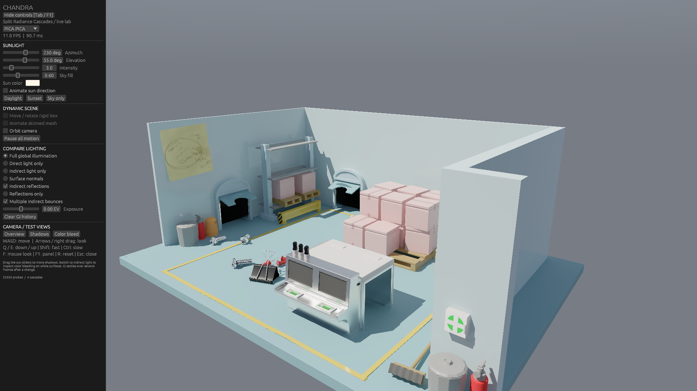

# PICA PICA 独占 GPU 性能复测 · 2026-10-27

> 本页是优化前的历史基线。后续相机采样、遍历和调度修复的同版本数据见
> [当前性能与质量复查](../optimized-v2/README.md)。以下“当前”均指本页记录的旧二进制。

**当前混合间接高光版本尚未达到实时性能要求。** 已经用户授权关闭另一个项目的
`Albor.Runtime.exe`，窗口正常退出；其诊断伴随进程也已退出。测试前 GPU 占用为 1%，
每组结束后为 0–1%。四组顺序运行，无并发渲染进程。

## 条件与结果

- NVIDIA GeForce RTX 5070 Ti，驱动 617.42，1920×1080，PICA PICA 视角 1。
- 采用修正后的 28 种材质及 6 张贴图，开启多次间接反弹；数值 GGX / RC / RT，未接入 LTC 或 ReSTIR。
- 基础预算 16，实际根据表面和历史提升到 32／64／128；未为性能测试降低画质设置。
- 每组预热 200 帧，记录随后 120 帧；模拟步长 1/60 秒，无帧率上限。
- 动态组使用 `combined` 相机轨迹和 `oscillate` 光源轨迹，与画质测试使用的路径定义相同。

| 条件 | 间接高光均值 ms | 间接高光 P95 ms | GI 含历史均值 ms | 第 300 帧应用平滑 FPS |
| --- | ---: | ---: | ---: | ---: |
| [静止，开启间接高光](static/summary.csv) | 79.08 | 80.46 | 8.63 | 11.0 |
| [相机与光源同时运动，开启间接高光](combined/summary.csv) | 173.33 | 186.96 | 24.71 | 5.8 |
| [静止，关闭间接高光](static-no-specular/summary.csv) | 0.00 | 0.00 | 8.73 | 95.1 |
| [相机与光源同时运动，关闭间接高光](combined-no-specular/summary.csv) | 0.00 | 0.00 | 24.59 | 42.9 |

**FPS 列是应用日志中第 300 帧的平滑读数，不是 120 帧的算术平均帧率。**
各阶段耗时由 CUDA events 记录，范围包含命令提交间隙，因此不能等同于纯 GPU kernel 时间。
静止／动态开启高光时，各已记录阶段均值之和分别为
88.13／198.45 ms；
该总和没有覆盖所有 UI、呈现与主机开销，也不作为完整帧时间。

反射追踪静止为 78.48 ms、动态为 172.69 ms；反射重建仅为 0.60／0.64 ms。
当前主要瓶颈在路径采样、追踪及命中着色。运动时的历史拒绝与自适应补采样增加了成本；
此处没有逐像素统计预算的性能捕获，不能将全部增量定量归因于某一触发器。
关闭反射后，动态 GI 仍约 24.59 ms，说明整体达到 60 FPS 还需要改善基础 GI 路径。

先前连续帧画质检查保持有效，但固定 60 Hz 模拟录制的视频不证明实时流畅。
本轮只复测和记录性能，没有改动采样、滤波或材质，没有降低验收画质。
后续优化重点应为减少中高粗糙度分支逐像素多射线与命中着色的工作量；
RC 区域积分 / LTC 是待实现并验证的方向，尚无其性能或画质提升数据。

## 原始记录

[结果 JSON](results.json) · [测试前环境](environment-before.json) ·
[静止阶段耗时](static/passes.csv) · [动态阶段耗时](combined/passes.csv) ·
[静止日志](static/run.log) · [动态日志](combined/run.log) ·
[关闭反射静止日志](static-no-specular/run.log) · [关闭反射动态日志](combined-no-specular/run.log)

四个子目录各保存参数、进程检查、二进制和场景哈希、GPU 遥测、原始 CSV 与日志。
本轮二进制与[最终高分辨率画质检查](../motion/large-receipts.json)的候选哈希相同：
`62cfb8a31d9df711c5e52177da17e24c9a94e1418980865ac4b6b9dc354a051b`。
场景 glTF 哈希也一致。所有测试正常退出，输出通过原有非有限值检查。
受 Albor 干扰的旧 `.local/pica-net-profile` 数据和错误 Glossiness 导入时的 4.85 ms 均不代表当前版本。



## 复现

在其他 GPU 工作负载退出后运行；不要并行运行以下命令。

```powershell
$env:PATH = (Join-Path (Get-Location) '.local/cuda/bin') + ';' + $env:PATH
$profileArgs = @('--scene-worker', '--pica-pica', '--1080p', '--static', '--view', '1', '--profile', '--profile-frames', '120', '--specular-samples', '16')
& ./target/debug/lighting_lab.exe @profileArgs --output .local/pica-profile-static
& ./target/debug/lighting_lab.exe @profileArgs --quality-camera-track combined --quality-light-track oscillate --output .local/pica-profile-combined
& ./target/debug/lighting_lab.exe @profileArgs --no-specular --output .local/pica-profile-static-off
& ./target/debug/lighting_lab.exe @profileArgs --quality-camera-track combined --quality-light-track oscillate --no-specular --output .local/pica-profile-combined-off
```

PICA PICA 场景与渲染所用资产：**SEED / Electronic Arts，CC BY-NC 4.0**。
[来源与许可](../../../resources/pica-pica/SOURCE.md) · [动态画质验证](../motion/README.md)
